<a href="https://wena.one">
  <picture>
    <source media="(prefers-color-scheme: dark)" srcset="assets/hero-dark.svg">
    
  </picture>
</a>

<a href="https://wena.one"><picture><source media="(prefers-color-scheme: dark)" srcset="assets/btn-wena-dark.svg"></picture></a>
<a href="https://www.linkedin.com/in/wessel-van-der-vlugt-351213254/"><picture><source media="(prefers-color-scheme: dark)" srcset="assets/btn-linkedin-dark.svg"></picture></a>

### About

IT consultant and developer at VVA, working where technology, organisations and people meet: from first intake to architecture, build, rollout and adoption. Business IT graduate, now doing a master's, heading for solution architecture.

<picture>
  <source media="(prefers-color-scheme: dark)" srcset="assets/competences-dark.svg">
  
</picture>

### Projects

<a href="https://mtgf.net"><picture><source media="(prefers-color-scheme: dark)" srcset="assets/card-mtgf-dark.svg"></picture></a>
<a href="https://ordo.wena.one"><picture><source media="(prefers-color-scheme: dark)" srcset="assets/card-ordo-dark.svg"></picture></a>
<a href="https://github.com/TBLgGamin/piikey"><picture><source media="(prefers-color-scheme: dark)" srcset="assets/card-piikey-dark.svg"></picture></a>
<a href="https://github.com/TBLgGamin/pokeum"><picture><source media="(prefers-color-scheme: dark)" srcset="assets/card-pokeum-dark.svg"></picture></a>
