<a href="https://wena.one">
  <picture>
    <source media="(prefers-color-scheme: dark)" srcset="assets/hero-dark.svg">
    
  </picture>
</a>

  <a href="https://wena.one"><picture><source media="(prefers-color-scheme: dark)" srcset="assets/link-wena-one-dark.svg"></picture></a>&nbsp;
  <a href="https://mtgf.net"><picture><source media="(prefers-color-scheme: dark)" srcset="assets/link-mtgf-net-dark.svg"></picture></a>&nbsp;
  <a href="https://www.linkedin.com/in/wessel-van-der-vlugt-351213254/"><picture><source media="(prefers-color-scheme: dark)" srcset="assets/link-linkedin-dark.svg"></picture></a>

 

I'm a solutions architect. My work is application landscapes: which systems exist, how they connect, and every point where a person touches them. That map is changing. Systems are starting to act on their own, so a growing part of the job is deciding which interaction points an agent may take over, when it has to ask first, and what a human always keeps.

### The handoff

<picture>
  <source media="(prefers-color-scheme: dark)" srcset="assets/spectrum-dark.svg">
  
</picture>

### Things I build to find out

<a href="https://mtgf.net"><picture><source media="(prefers-color-scheme: dark)" srcset="assets/project-mtgf-dark.svg"></picture></a>

<a href="https://github.com/TBLgGamin/pokeum"><picture><source media="(prefers-color-scheme: dark)" srcset="assets/project-pokeum-dark.svg"></picture></a>

<a href="https://github.com/TBLgGamin/piikey"><picture><source media="(prefers-color-scheme: dark)" srcset="assets/project-piikey-dark.svg"></picture></a>

 

More work and case studies on <a href="https://wena.one">wena.one</a>

