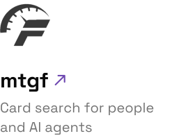
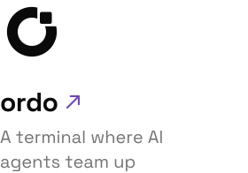
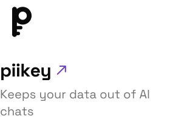
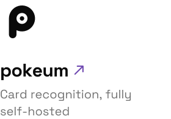

<picture>
  <source media="(prefers-color-scheme: dark)" srcset="assets/hero-dark.f89388a2.svg">
  
</picture>

<a href="https://wena.one"><picture><source media="(prefers-color-scheme: dark)" srcset="assets/link-wena-dark.49e0a385.svg"></picture></a>&emsp;&emsp;<a href="https://www.linkedin.com/in/wessel-van-der-vlugt-351213254/"><picture><source media="(prefers-color-scheme: dark)" srcset="assets/link-linkedin-dark.61eca0a9.svg"></picture></a>

  

<picture>
  <source media="(prefers-color-scheme: dark)" srcset="assets/interests-dark.3044a9d0.svg">
  
</picture>

  

<picture>
  <source media="(prefers-color-scheme: dark)" srcset="assets/building-dark.c0189378.svg">
  
</picture>

<a href="https://mtgf.net"><picture><source media="(prefers-color-scheme: dark)" srcset="assets/project-mtgf-dark.96958837.svg"></picture></a>&nbsp;<a href="https://github.com/TBLgGamin/ordo"><picture><source media="(prefers-color-scheme: dark)" srcset="assets/project-ordo-dark.16fbe6e6.svg"></picture></a>&nbsp;<a href="https://github.com/TBLgGamin/piikey"><picture><source media="(prefers-color-scheme: dark)" srcset="assets/project-piikey-dark.fbd3a959.svg"></picture></a>

 

<a href="https://github.com/TBLgGamin/pokeum"><picture><source media="(prefers-color-scheme: dark)" srcset="assets/project-pokeum-dark.fb31c79a.svg"></picture></a>&nbsp;<a href="https://github.com/TBLgGamin/readana"><picture><source media="(prefers-color-scheme: dark)" srcset="assets/project-readana-dark.e9819b5d.svg"></picture></a>
