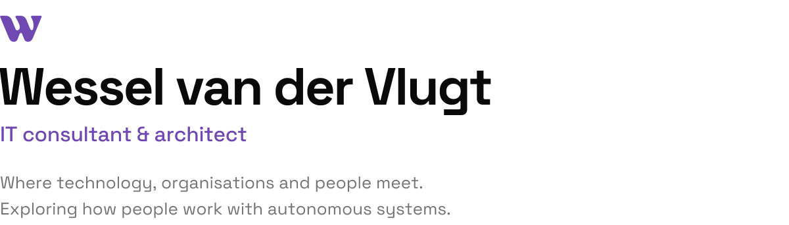
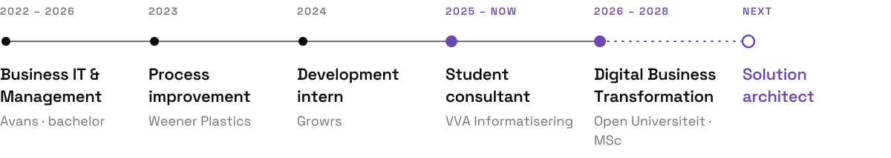
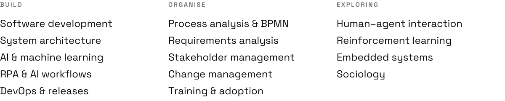
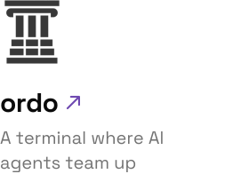
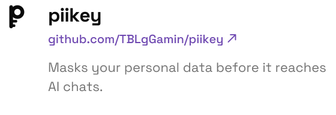
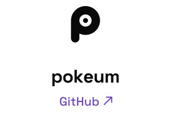

<picture>
  <source media="(prefers-color-scheme: dark)" srcset="assets/header-dark.svg">
  
</picture>

<a href="https://wena.one"><picture><source media="(prefers-color-scheme: dark)" srcset="assets/link-wena-dark.svg"></picture></a>&emsp;&emsp;<a href="https://www.linkedin.com/in/wessel-van-der-vlugt-351213254/"><picture><source media="(prefers-color-scheme: dark)" srcset="assets/link-linkedin-dark.svg"></picture></a>

  

<picture>
  <source media="(prefers-color-scheme: dark)" srcset="assets/path-dark.svg">
  
</picture>

  

<picture>
  <source media="(prefers-color-scheme: dark)" srcset="assets/competences-dark.svg">
  
</picture>

  

<a href="https://mtgf.net"><picture><source media="(prefers-color-scheme: dark)" srcset="assets/project-mtgf-dark.svg"></picture></a>&nbsp;<a href="https://ordo.wena.one"><picture><source media="(prefers-color-scheme: dark)" srcset="assets/project-ordo-dark.svg"></picture></a>&nbsp;<a href="https://github.com/TBLgGamin/piikey"><picture><source media="(prefers-color-scheme: dark)" srcset="assets/project-piikey-dark.svg"></picture></a>&nbsp;<a href="https://github.com/TBLgGamin/pokeum"><picture><source media="(prefers-color-scheme: dark)" srcset="assets/project-pokeum-dark.svg"></picture></a>
