<a href="https://wena.one">
  <picture>
    <source media="(prefers-color-scheme: dark)" srcset="assets/hero-dark.svg">
    
  </picture>
</a>

I design application landscapes: the systems an organisation runs on, how they connect, and every point where a person touches them. More and more of those systems act on their own, so the question I care about is what to hand over, when a system should ask first, and what a human always keeps.

[wena.one](https://wena.one) · [LinkedIn](https://www.linkedin.com/in/wessel-van-der-vlugt-351213254/)

### Side projects, from assisted to autonomous

<picture>
  <source media="(prefers-color-scheme: dark)" srcset="assets/work-dark.svg">
  
</picture>

[pokeum](https://github.com/TBLgGamin/pokeum) · [mtgf.net](https://mtgf.net) · [piikey](https://github.com/TBLgGamin/piikey) · [ordo](https://ordo.wena.one)
